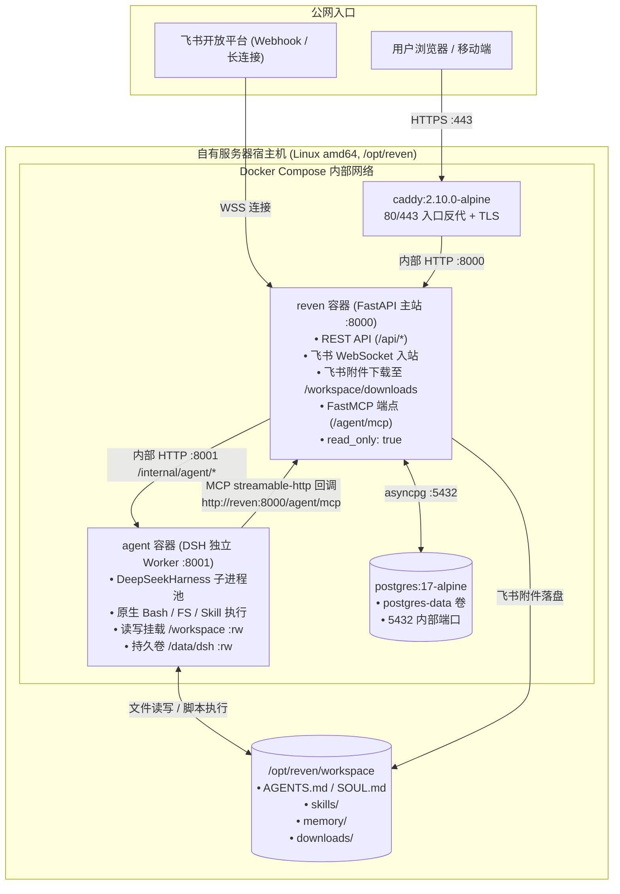

# Reven Agent 架构（独立 DSH Agent 容器核心）

Reven 的 Agent 核心由 DeepSeek Harness（dsh，sdk profile）承载 LLM 推理、原生系统能力编排与工具调度。在生产环境中，Agent 作为独立的 `agent` 容器运行，拥有独立的可写 `/workspace` 工作区和高并发 `pids_limit`，与保持只读安全边界的 `reven` Web 容器解耦；本地单机开发时亦可直接由进程内 `AgentRuntime` 拉起。工具调用经 FastMCP streamable-http loopback 回调 `reven` 容器执行，覆盖 CRM（15 个）、人才库（18 个）、RSS（4 个）共 37 个业务工具。

## 1. 架构总览

### 完整请求链路

1. **对话发起**：用户在 Web 页面（`POST /api/agent/chat`）或飞书私聊/群聊 @机器人发送消息。
2. **附件处理**：若消息包含 Excel 等文件附件，`FeishuChatDispatcher` 通过飞书开放平台安全下载至 `/workspace/downloads/`，并将文件绝对路径与指令注入提示词。
3. **Agent 转发**：`AgentService` 通过内网 HTTP 请求转发至 `agent` 容器 Worker（`POST /internal/agent/chat`）。
4. **推理与原生工具编排**：`DeepSeekHarness` 子进程启动推理：
   - 可调用原生 Linux 工具：`tool-bash`、`tool-fs`、`tool-skill`，读取 `/workspace` 文件或加载业务 Skill。
   - 依赖环境已预装 `pandas`、`numpy`、`openpyxl`，支持自动化分析报表。
5. **业务工具回调**：当模型决定调用 Reven 业务时，经 patch 注入的 `@deepseek-ai/dsh-mcp-client` 以 streamable-http 回调 `http://reven:8000/agent/mcp`，由 FastMCP 校验 Bearer token 后直连数据库或领域服务。
6. **响应交付**：最终结果原路返回，飞书回复卡片或 Web 统一展示。

## 2. 模块边界 (`server/src/reven/agent/`)

| 文件 | 职责 |
|---|---|
| `config.py` | `AgentConfig` 与配置解析：integrations 表优先、env fallback；`cwd` 绑定 `workspace_root`，`dsh_home` 绑定运行时数据卷 |
| `runtime.py` | `AgentRuntime`：持有 `DeepSeekHarness` 单例与按模型缓存池，提供 start/close/chat 与会话重铸容错 |
| `worker.py` | 独立容器 Worker 进程：在 8001 端口提供内部 HTTP 接口（`/internal/agent/*`） |
| `client.py` | `AgentRuntimeProtocol` 与 `RemoteAgentWorkerClient`：解耦本地直连与容器内网 HTTP 通信 |
| `service.py` | 共享 `AgentService`：会话模型选择、状态管理与单轮生效身份，REST/飞书复用 |
| `mcp_server.py` | FastMCP streamable-http 子应用：37 个业务工具注册与 Bearer token 校验 |
| `dsh.patch.yml` | profile patch：注入 MCP 客户端，开放 Linux 原生工具，注入工作区人设与行为提示词 |
| `tools_crm_*.py` | 15 个 CRM 领域工具集 |
| `tools_talents_*.py` | 18 个人才库领域工具集 |
| `tools_rss.py` | 4 个 RSS 关键词维护工具集 |
| `errors.py` | 错误类型与稳定错误码（503 未配置 / 502 运行时不可用 / 404 模型未注册） |

## 3. 工作区规范与人设融合

DSH 工作目录绑定为 `/workspace`（宿主机 `/opt/reven/workspace`）：
- `AGENTS.md`：定义工作区规范、行为红线与会话守则。
- `SOUL.md`：定义核心人设（“小龙虾”全能助理，具有记忆感与陪伴感）。
- `skills/`：内置如 `daily-triple-report-v2`（销售三联日报）、`full-inventory-check`（全量库存动销盘点）等专业分析 Skill。
- `downloads/`：飞书收取的附件由 `reven` 容器写入，供 `agent` 容器处理。

## 4. 部署与全栈 Compose

在自有服务器上，`infra/compose/docker-compose.yml` 声明了全栈服务：
- `postgres`：PostgreSQL 17，持久化数据库；
- `agent`：DSH Worker，读写挂载 `/opt/reven/workspace` 与 `dsh-data`；
- `reven`：FastAPI 主站，只读容器，对外服务 REST API 与飞书长连接；
- `caddy`：入口反代，自动申请并续签 HTTPS 证书。

更新由 `scripts/deploy_reven.sh` 脚本按 digest 一键交付。
