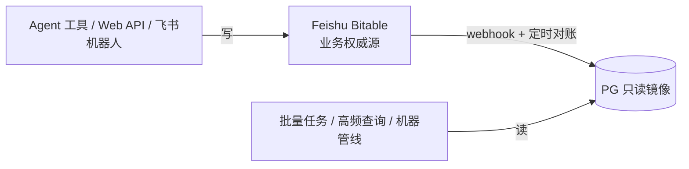

# Reven 数据架构：权威源与飞书边界

Reven 的定位是 Agent Runtime + 管理端：**业务数据与文档的权威源在飞书（多维表格 / 文档 / 知识库）；管理数据、运行数据与机器计算数据的权威源在 PostgreSQL，业务数据在 PG 保留只读镜像。**

本文是数据边界的唯一权威表述。实现争议以本文为准；修改边界先改本文。

## 1. 数据归属边界

| 维度 | 飞书（权威源） | PostgreSQL（权威源 + 只读镜像） |
|---|---|---|
| RSS | 候选条目审核表（阶段见 §5） | 向量、评分等机器计算字段 + 候选只读镜像 |
| CRM | 客户、联系人、跟进记录、跟进计划 | 提醒扫描等只读镜像 |
| 人才库 | 人才档案、跟进记录 | 只读镜像 |
| 文档 | 周报、SOP、知识库 | —— |
| 管理/运行 | —— | 凭证、调度、通知日志、Agent 会话、审计 |

判定口径：需要人协作维护、审核、归档的业务记录 → 飞书；机器高频计算、运行态、配置与凭证 → PG。

## 2. 目标读写路径

- **写路径**统一进 Bitable，业务写不直接落 PG（镜像由同步刷新）
- **读路径**：批量、高频、机器管线走 PG 镜像；单条详情可按需回源 Bitable
- **PG 镜像不是优化而是必需品**：飞书 API 故障时承担降级读；写失败入队列重放

## 3. 硬后果与对策

| 后果 | 对策 |
|---|---|
| 事务性丧失：Bitable 无跨表事务 | 跨表写补偿/重试；实体间关联从外键降级为 record_id 引用 |
| 查询降级：无 join/聚合 | 排序字段在 Bitable 冗余（去规范化）；复杂报表走 PG 镜像 |
| 可用性耦合：飞书故障 = 业务读写中断 | 镜像降级读 + 写队列重放 |
| Bitable 能力边界：附件/富文本/关联字段受限 | 表结构设计期提前规划；PG JSONB → 多选/文本字段逐一确认映射 |

## 4. 明确不做清单

- **不做状态回写**（#229 落地前）：飞书侧人工修改不回写 PG，审核动作仍在 Web 端完成
- **不预建通用 PG 镜像基建**：镜像机制推迟到 CRM/人才库迁移（#228）按真实需求建设
- **机器计算字段不入飞书**：embedding 向量、评分只存 PG，不做跨端同步

## 5. 落地状态（截至 2026-11）

| 域 | 当前阶段 | 权威源现状 |
|---|---|---|
| RSS 候选 | 单向投影，回写通道试点中 | PG（飞书侧为审核视图） |
| CRM | 迁移未启动 | PG |
| 人才库 | 迁移未启动 | PG |
| 文档 | 放飞书 | 飞书 |

落地顺序与 issue 跟踪：

1. #226 RSS 候选表 → Bitable 单向投影
2. #229 审核状态回写通道（RSS 单字段试点）
3. #228 CRM/人才库权威数据迁移
4. #227 方向跟踪（以上全部完成后关闭）

每完成一个域，随实现 PR 更新本节，避免状态过时。

## 6. 飞书侧前置条件

- 开放平台权限：`bitable:record`、`drive:drive`（按域递增开通）
- 应用机器人加为对应数据表协作者（tenant token 需协作者身份才能读写表）
